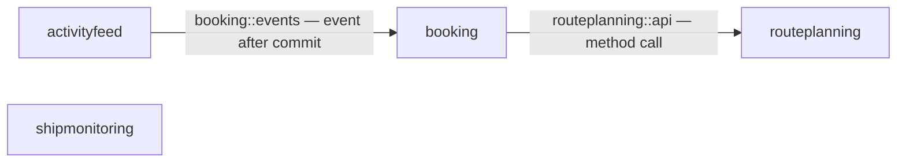
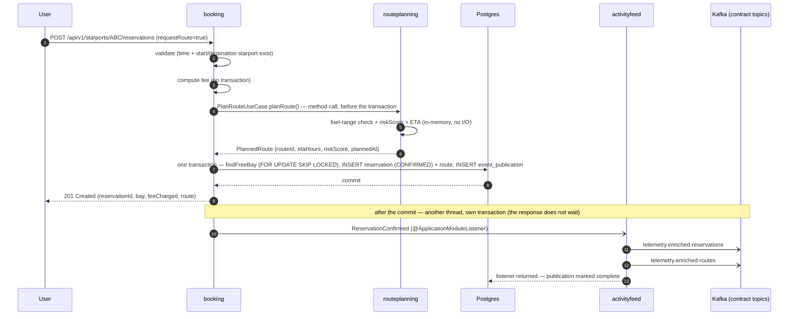
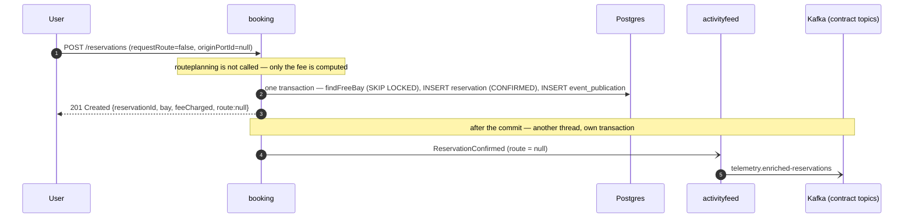
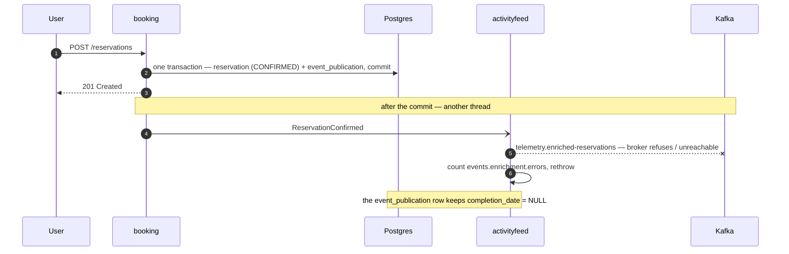
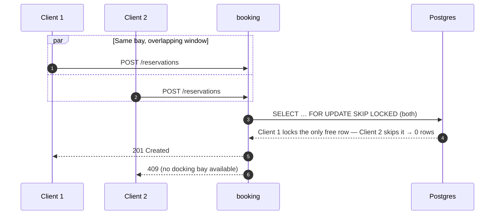
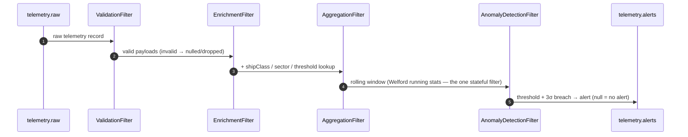

# 🪐 Galactic Fleet — one Spring Modulith application

A galactic trade system built as **one application with four modules** — a learning
project that demonstrates a modular monolith with machine-checked module boundaries, events between
modules that are delivered after the commit, end-to-end tracing, and a production-shaped
observability stack, all runnable from a single `docker compose` command.

> **Status — implemented & running.** The fleet used to be five processes (three business services
> with two replicas each, an API gateway and a Eureka registry). On this branch it is **one process**:
> `galactic-fleet`, a [Spring Modulith](https://spring.io/projects/spring-modulith) application
> ([ADR-0043](adr/0043-fleet-as-one-spring-modulith.md)). Its modules were then re-cut along the
> domains instead of along the former services — `booking`, `routeplanning`, `shipmonitoring`,
> `activityfeed` ([ADR-0046](adr/0046-disjoint-domains-and-events-after-commit.md)): a reservation is
> one transaction, modules exchange events after the commit, and Kafka carries only computed
> telemetry. The HTTP API and the metric names are unchanged; the contract is pinned by a black-box
> test suite ([`system-acceptance/`](system-acceptance)). The microservice variant lives on the
> `demo` branch and in git history.

| | |
|---|---|
| **Runtime** | Java 21 · Virtual Threads |
| **Framework** | Spring Boot 3.5.6 · Spring Modulith 1.4.13 · Spring Cloud Stream |
| **Messaging** | Apache Kafka 3.7 (KRaft) — only at the edge of the system |
| **Data** | PostgreSQL 16 · Spring Data JPA · Flyway |
| **Observability** | OTel Collector · Prometheus · Grafana · Tempo · Loki · Alloy |
| **Build / QA** | Maven · Testcontainers · JUnit 5 · PIT · ArchUnit · Error Prone / NullAway · Spotless |

---

## 🚀 Quick Start

```bash
# From repo root:
cd infra/docker
docker compose -f docker-compose.modulith.yml up --build -d   # app + postgres + kafka + observability

# Wait for healthchecks (roughly 60–90 s on first run)
docker compose -f docker-compose.modulith.yml ps

# Smoke test — create a reservation
curl -X POST http://localhost:8080/api/v1/starports/ABC/reservations \
  -H "Content-Type: application/json" \
  -d '{
    "customerCode": "CUST-001",
    "shipCode": "SS-Enterprise-01",
    "shipClass": "SCOUT",
    "startAt": "2031-05-01T10:00:00Z",
    "endAt":   "2031-05-01T11:00:00Z",
    "requestRoute": false,
    "originPortId": null
  }'

# Black-box acceptance suite against the running stack (HTTP + Kafka + Prometheus)
mvn -f system-acceptance/pom.xml test
```

Tear down with `docker compose -f docker-compose.modulith.yml down` (add `-v` to also wipe the Grafana
and Prometheus volumes). Postgres is intentionally ephemeral (tmpfs) — every restart wipes the DB
and Flyway replays the seed.

---

## 2. Tech Stack

| Concern | Technology | ADR |
|---|---|---|
| Language / Runtime | **Java 21** + Virtual Threads (Project Loom) | ADR-0012 |
| Framework | **Spring Boot 3.5.6** | ADR-0025 |
| Module boundaries | **Spring Modulith 1.4.13** — `ApplicationModules.verify()` in the build; `allowedDependencies` per module | ADR-0043, 0044, 0046 |
| Module-to-module calls | plain method call through a module's `api` named interface (one such call exists) | ADR-0044, 0046 |
| Module-to-module events | Spring application events, delivered after the commit (`@ApplicationModuleListener`) | ADR-0046 |
| Messaging at the edge | **Apache Kafka 3.7 (KRaft)** via Spring Cloud Stream (StreamBridge + one functional bean) | ADR-0016, 0019 |
| Event delivery | Spring Modulith **Event Publication Registry** (`spring-modulith-starter-jpa`, table `event_publication`) — at-least-once | ADR-0046 |
| Persistence | **PostgreSQL 16** + Spring Data JPA + **Flyway** | ADR-0007, 0018 |
| Concurrency safety | `SELECT … FOR UPDATE SKIP LOCKED` + range-overlap query + `@Version` | ADR-0020 |
| Telemetry hub | **OTel Collector** (tail sampling for traces, 100% logs) | ADR-0037 |
| Metrics | Micrometer Observation API → **Prometheus** (15 days local retention) | ADR-0005, 0030, 0047 |
| Traces | OTLP → Collector → **Tempo** | ADR-0017, 0037 |
| Logs | OTLP appender (app) + **Alloy** (infra stdout) → **Loki** | ADR-0035, 0037 |
| Dashboards | **Grafana** (auto-provisioned) | ADR-0005, 0033 |
| Validation | Jakarta Bean Validation + Chain of Responsibility | ADR-0023 |
| Testing | **JUnit 5** + **Testcontainers** + `TestObservationRegistry` + **PIT** + **ArchUnit** + black-box system suite | ADR-0006, 0029, 0011 |
| Build | Maven + BOM pinning + **Error Prone / NullAway** + **Spotless** | ADR-0025 |
| Container | Multi-stage Dockerfile (Temurin 21 JRE, container-aware JVM) | ADR-0026 |
| Deployment | Docker Compose, one application instance | ADR-0043 |

---

## 3. Domain — The Galactic Trade Network

A fictional interstellar logistics network. Each bounded context is a **module** of the same
application: a direct subpackage of `com.galactic.fleet`. A module's API is its
**named interfaces** — subpackages `api` and `events` marked with `@NamedInterface`; every other
subpackage is internal and unreachable from other modules. Each module's `package-info.java` lists
the only named interfaces it may use (`allowedDependencies`, ADR-0044).

### `booking` — the system of record
**Starports, docking bays, customers, ships, reservations and the berth tariff.** The only database
owner: REST, bay allocation under a pessimistic lock, fee calculation, JPA. A reservation is stored
in **one transaction**, together with the `ReservationConfirmed` event. Internally layered
(`controller` → `service` → `repository`).
**API:** the `events` named interface — the `ReservationConfirmed` event (it carries the route data
too); nobody calls into this module. **Depends on:** `routeplanning::api`.

### `routeplanning` — routes between star systems
Plans a **trade route** for a ship class: fuel-range check, corridor risk, ETA. A pure computation —
no database, no Kafka, no events, no I/O. What each ship class can fly lives here
(`ShipFuelRanges`); the caller only names the class.
**API:** the `api` named interface — `PlanRouteUseCase` with `RouteRequest`, `PlannedRoute` and
`RouteRejectionException`. **Depends on:** nothing.

### `shipmonitoring` — Pipes & Filters
Ingests real-time starship **sensor readings** from Kafka (`telemetry.raw`) and runs them through a
chain of filters, raising alerts on anomalies (`telemetry.alerts`). Fully self-contained: it
publishes no application events and listens to none.
**API:** none. **Depends on:** nothing.

### `activityfeed` — what leaves the system about a reservation
Listens to `ReservationConfirmed` and turns it into the computed records published on Kafka:
`telemetry.enriched-reservations` and, when the reservation has a route, `telemetry.enriched-routes`.
It runs after the publisher's commit, on another thread, in its own transaction.
**API:** none — it is a pure listener. **Depends on:** `booking::events`.

### Outside the modules
Two platform configuration classes sit in the root package `com.galactic.fleet` and belong to no
module: `AsyncTracingConfiguration` (carries the trace context onto the listener threads) and
`OtelLogbackInstaller` (wires the OTLP logback appender). No business module depends on them.

---

## 4. System Architecture Diagram

```
                      :8080 (the only application port)
        User ─────────────────────────────┐
                                          ▼
 ┌──────────────────────────────── galactic-fleet (one process) ────────────────────────────────┐
 │                                                                                               │
 │  ┌───────────────────┐   method call (module API)    ┌──────────────────────┐                │
 │  │      booking      │ ────────────────────────────► │    routeplanning     │                │
 │  │  REST · JPA ·     │   PlanRouteUseCase — before   │  fuel range · risk · │                │
 │  │  one transaction  │   the transaction opens       │  ETA (pure function) │                │
 │  └─────────┬─────────┘                               └──────────────────────┘                │
 │            │ ReservationConfirmed (application event)                                        │
 │            │ stored in event_publication inside the reservation transaction,                 │
 │            │ delivered after the commit, on another thread                                   │
 │            ▼                                                                                 │
 │  ┌───────────────────┐                               ┌──────────────────────┐                │
 │  │   activityfeed    │                               │    shipmonitoring    │                │
 │  │ enriched records  │                               │   Pipes & Filters    │ ◄──────────────┼── telemetry.raw (Kafka,
 │  └─────────┬─────────┘                               └──────────┬───────────┘                │    external producers)
 │            │                                                    │                            │
 └────────────┼────────────────────────────────────────────────────┼────────────────────────────┘
              ▼ Kafka OUT                                          ▼ Kafka OUT
     telemetry.enriched-reservations                        telemetry.alerts
     telemetry.enriched-routes

   galactic-fleet ──►  OTel Collector :4318  ──►  tail-sample ──►  Tempo (traces)
                                             └──►  100%        ──►  Loki  (logs)
   Prometheus :9090  ──►  scrapes galactic-fleet:8080/actuator/prometheus
   Alloy  ──►  scrapes INFRA container stdout (kafka, postgres, grafana…) ──►  Loki
```

### Module dependency map

| Module | Depends on (`allowedDependencies`) | How |
|---|---|---|
| `booking` | `routeplanning::api` | calls `PlanRouteUseCase` (the route is part of the HTTP response) — synchronous, before the transaction |
| `routeplanning` | — | — |
| `shipmonitoring` | — | — |
| `activityfeed` | `booking::events` | listens to `ReservationConfirmed` after the commit — the event type only |



Two edges, no cycles (ADR-0046). `ModularityTest` (`ApplicationModules.verify()`) fails the build —
even the fast `-Pfast` loop — on a cycle, on a reference into another module's internal subpackage,
or on a dependency missing from the module's `allowedDependencies` (ADR-0044). The same test checks
that `routeplanning` exposes no `events` named interface and that every module is `Type.CLOSED`.

**Kafka is the edge, not the wiring.** No topic is consumed by another module of this application.
`telemetry.raw` is the inbound edge; the three outbound topics — all of them computed telemetry —
are the contract with external consumers. Inside the process, modules use one method call and one
application event.

**Runtime dependencies of the process:** Postgres, Kafka, OTel Collector (`depends_on` in Compose).

### Request lifecycle — when DB, Kafka and filters actually fire

A single `requestRoute=true` reservation, step by step (verified against the code):

1. **HTTP in.** `ReservationController.create()` maps the JSON to a command.
2. **Validation (no writes).** `ReserveBayValidator` runs the Chain of Responsibility: time validity → start-starport exists → destination-starport exists.
3. **Fee + route — no transaction.** `ReservationService` computes the fee (`FeeCalculator`), then asks the `routeplanning` module for the route through `RoutePlanner` → `PlanRouteUseCase.planRoute()`. The route is computed **in memory**: fuel-range check for the ship class, corridor risk, ETA. Nothing is published and nothing is written. A rejected route ends the request here with `422 ROUTE_REJECTED` — before anything was stored, so there is nothing to compensate.
4. **The one transaction.** `ReservationConfirmer.confirm()` (`@Transactional`) calls `StarportPersistenceFacade.createConfirmedReservation()`: `SELECT … FOR UPDATE SKIP LOCKED` grabs a free bay (no bay → `409`), the reservation is `INSERT`ed as `CONFIRMED` with its fee and its `route` row. Still inside the transaction, `ReservationConfirmed` is published; the Event Publication Registry writes it to `event_publication`. Reservation and publication **commit together or not at all**. **No Kafka call happens here**, so the bay lock is held only briefly.
5. **HTTP out.** `201 Created` returns to the user. It does not wait for the listener and cannot be failed by it.
6. **After the commit — another thread, another transaction.** `activityfeed`'s `FleetEventListener` (`@ApplicationModuleListener`) receives `ReservationConfirmed`, computes the enriched reservation record and writes it to `telemetry.enriched-reservations`; when the reservation has a route it also writes `telemetry.enriched-routes`. When the listener returns normally the publication is marked complete. If it throws, the failure is counted (`events.enrichment.errors`) and rethrown, and the row stays incomplete in `event_publication` (see Flow C). Delivery is **at-least-once** (ADR-0046).
7. **Independently — the sensor pipeline.** Every message on `telemetry.raw` goes through the composed filter chain of `shipmonitoring` (`validation → enrichment → aggregation → anomaly`): a `null` from any stage short-circuits the rest (message dropped), each stage is timed (`telemetry.filter.*`), and only `AggregationFilter` holds state (per-`(ship,sensor)` Welford windows). A non-null `AnomalyAlert` is published to `telemetry.alerts`.

> **The two key timing facts:** (a) the route is computed **before** the transaction opens — the two
> modules share a thread, never a transaction. (b) a reservation is **never announced in the request
> thread** — only a row in `event_publication` is written with the reservation; the listener runs
> after the commit, so a Kafka outage cannot change the HTTP response.

---

## 5. Process Flows

### Flow A — Reserve docking bay + route planning (happy path)



### Flow B — Reserve docking bay, no route (`requestRoute: false`)



### Flow C — The listener fails after the commit (publication stays incomplete)



The reservation is already committed and the user already has the `201` — a Kafka outage no longer
changes the HTTP response (ADR-0046). `FleetEventListener` never swallows the failure: the Event
Publication Registry marks a publication complete only when the listener returns normally, so the
incomplete row is the record that this event still has to be delivered. Delivery is therefore
**at-least-once**: if the reservation record was sent and the route record failed, a re-delivery
sends the reservation record a second time — consumers of `telemetry.enriched-*` deduplicate on the
record key (reservation id / route code).

**Re-delivery (ADR-0048).** `EventPublicationMaintenance` runs every minute and re-submits
publications older than one minute; a Postgres advisory lock lets one instance at a time do it. The
event carries the `traceparent` of the original request, so the re-delivered records land in that
request's trace. A completed publication is deleted (`completion-mode: delete`), so the table holds
only what is still waiting — visible as `events.publications.incomplete` and
`events.publications.oldest.age`. There is no dead-letter: an event that never succeeds is retried
every round and shows up as a growing oldest age.

A rejected route is the other non-happy path, and it is much shorter: `routeplanning` throws
`RouteRejectionException` before the transaction opens → `422 ROUTE_REJECTED`, nothing written.
There is no retry, no circuit breaker and no compensation anywhere on the reservation path.

### Flow D — Concurrent reservation conflict



The lock lives inside the single reservation transaction, until its commit. Client 2 has written
nothing, so there is nothing to release.

### Flow E — Sensor pipeline in `shipmonitoring` (Pipes & Filters)



---

## 6. HTTP API Reference

### `POST /api/v1/starports/{code}/reservations` — the only business endpoint, `:8080`

Creates a docking-bay reservation (stored as `CONFIRMED` in one transaction), optionally planning a
route.

**Request** (`ReservationCreateRequest`, Jakarta-validated — ADR-0023):

```json
{
  "customerCode": "CUST-001",
  "shipCode": "SS-Enterprise-01",
  "shipClass": "SCOUT",
  "startAt": "2031-05-01T10:00:00Z",
  "endAt":   "2031-05-01T11:00:00Z",
  "requestRoute": true,
  "originPortId": "ALPHA-BASE"
}
```

| Field | Type | Constraint |
|---|---|---|
| `customerCode` | string | required, non-blank, must exist |
| `shipCode` | string | required, non-blank, must exist |
| `shipClass` | enum | required — `SCOUT` / `FREIGHTER` / `CRUISER` |
| `startAt` / `endAt` | ISO-8601 UTC | required, future, `startAt < endAt` |
| `requestRoute` | boolean | required |
| `originPortId` | string \| null | required when `requestRoute=true` |

**Response 201 Created** (`ReservationResponse`):

```json
{
  "reservationId": 42,
  "starportCode": "ABC",
  "bayNumber": "7",
  "startAt": "2031-05-01T10:00:00Z",
  "endAt":   "2031-05-01T11:00:00Z",
  "feeCharged": 57.50,
  "route": { "routeCode": "ROUTE-9F21A0C3", "etaHours": 12.7, "riskScore": 0.47 }
}
```

**Error responses** — the statuses and bodies are pinned by `ReservationApiSystemTest`:

| Status | Cause |
|---|---|
| 400 | Malformed JSON, wrong type, unknown `shipClass` value |
| 404 | Unknown starport, customer or ship |
| 409 | No free docking bay for the requested window (ADR-0020) |
| 422 | Bean Validation rejected the payload (missing/blank field) |
| 422 | `startAt >= endAt`, or dates in the past |
| 422 `ROUTE_REJECTED` | `routeplanning` deterministically rejected the route (insufficient range) |

There is no `409 ROUTE_UNAVAILABLE` any more: route planning publishes nothing, so it has no
technical failure to report (ADR-0046).

Route planning has **no HTTP endpoint**. In the microservice fleet `POST /api/v1/routes/plan` was an
internal server-to-server call; it is now `PlanRouteUseCase.planRoute()`, a method call between
modules (ADR-0043).

### Other endpoints

- **Actuator**: `/actuator/health`, `/info`, `/metrics`, `/prometheus`, `/liveness`, `/readiness`.

---

## 7. Kafka Topology

Kafka is the **edge** of the system: one inbound topic and three outbound contract topics, all of
them computed telemetry (ADR-0046). No topic is both produced and consumed by this application.

| Topic | Direction | Written / read by (binding) | Key | Partitions |
|---|---|---|---|---|
| `telemetry.raw` | **in** | `shipmonitoring` (`telemetryPipeline-in-0`, group `telemetry-pipeline`, 3 × 1 s retry, DLQ `telemetry.raw.dlq`) | ship id (required for correct aggregation with several instances; violations are counted in `telemetry.messages.key.mismatch`) | default (2) |
| `telemetry.alerts` | out | `shipmonitoring` (`telemetryPipeline-out-0`) | — | default (2) |
| `telemetry.enriched-reservations` | out | `activityfeed` (`enrichedReservations-out-0`) | reservation id | default (2) |
| `telemetry.enriched-routes` | out | `activityfeed` (`enrichedRoutes-out-0`) | route code | default (2) |

> Topics are auto-created on first publish (`autoCreateTopics: true`; off in the `prod` profile). The
> default partition count is `2` (broker `KAFKA_NUM_PARTITIONS`).

The topics `starport.reservations` and `starport.route-planned` **no longer exist**. They were the
wire between the services of the original fleet; inside one application the modules exchange an
application event, and the repository holds no consumer for them (ADR-0046). The route data now
travels inside `ReservationConfirmed`. The `processedBy` field of the enriched records is still
`telemetry-pipeline`.

Every outbound record carries a W3C `traceparent` header; the two records caused by one reservation
share the trace id of the HTTP request.

**Delivery guarantee.**
- **Enriched topics** — `ReservationConfirmed` is stored by the **Event Publication Registry** in the
  same DB transaction as the reservation and handed to `FleetEventListener` after the commit. A
  failed enrichment or send is counted in `events.enrichment.errors` and rethrown, which leaves the
  publication in `event_publication` until the re-delivery job succeeds — **at-least-once**, so consumers deduplicate
  on the record key (ADR-0046, ADR-0048).
- **`telemetry.raw`** — the consumer retries 3 × 1 s; payloads that fail message conversion go to
  `telemetry.raw.dlq`. An exception inside a filter is logged, counted and the message dropped.

---

## 8. Database Schema (`booking` module only)

Only the `booking` module owns business tables (ADR-0018); the Event Publication Registry keeps its
own `event_publication` table in the same database. DDL lives in
`galactic-fleet/src/main/resources/db/migration/` as Flyway versioned migrations:

| Migration | Purpose |
|---|---|
| `V1__starport_basic_model.sql` | Core aggregates + ID sequences (`INCREMENT BY 10`, pooled-lo) |
| `V2__test_data.sql` | Baseline seed (starports, customers, ships, bays) |
| `V3__create_event_outbox.sql` | `event_outbox` table (historical — dropped again by `V9`) |
| `V4__reservation_indexes.sql` | Composite indexes for the `findFreeBay` hot path |
| `V6__lookup_indexes.sql` | Indexes on `code` columns (starport / customer / ship) |
| `V7__reservation_optimistic_lock.sql` | Adds `reservation.version` for `@Version` optimistic locking |
| `V8__event_publication_registry.sql` | `event_publication` (+ partial index on incomplete rows) and `event_publication_archive` for the Event Publication Registry (ADR-0046) |
| `V9__drop_event_outbox.sql` | Drops `event_outbox` — the hand-written outbox is gone (ADR-0046) |

(There is deliberately no `V5`.)

Core tables (IDs are `BIGINT` from per-table sequences; `event_publication` uses a `UUID` id):

- **`starport`** — `code`, `name`, `description`, `created_at`, `updated_at`.
- **`docking_bay`** — `starport_id`, `bay_label`, `ship_class`, `status`. Target of the
  `FOR UPDATE SKIP LOCKED` lock (ADR-0020).
- **`customer`** — `customer_code`, `name`, timestamps.
- **`ship`** — `customer_id`, `ship_code`, `ship_class`.
- **`reservation`** — `starport_id`, `docking_bay_id`, `customer_id`, `ship_id`, `start_at`,
  `end_at`, `fee_charged` (`NUMERIC(14,2)`), `status`, `route_id`, `version`, timestamps. A
  reservation is born `CONFIRMED` — there is no `HOLD` state any more. `CANCELLED` remains as an
  enum value (the free-bay query already ignores such rows), but nothing sets it today. Overlap is
  checked against `(start_at, end_at)`.
- **`route`** — `reservation_id`, `route_code`, `start_port_code`, `destination_port_code`,
  `eta_light_years`, `risk_score` (one row per reservation when `requestRoute=true`).
- **`event_publication`** — `id` (UUID), `listener_id`, `event_type`, `serialized_event`,
  `publication_date`, `completion_date`. Written by the Event Publication Registry in the
  reservation transaction; `completion_date IS NULL` means the listener has not finished — yet, or
  because it failed (ADR-0046). `event_publication_archive` has the same columns and is used only
  with the registry's archive completion mode, which is not switched on.

The query that makes reservation concurrency safe (`DockingBayRepository.findFreeBay`):

```sql
-- ADR-0020: pick a free bay and lock it; concurrent callers SKIP the locked row.
SELECT docking_bay.*
FROM starport
JOIN docking_bay ON starport.id = docking_bay.starport_id
WHERE starport.code = :starportCode
  AND docking_bay.status = 'AVAILABLE'
  AND docking_bay.ship_class = :shipClass
  AND NOT EXISTS (
      SELECT 1 FROM reservation r
      WHERE docking_bay.id = r.docking_bay_id
        AND r.status <> 'CANCELLED'
        AND r.start_at < :endAt AND r.end_at > :startAt
  )
FOR UPDATE SKIP LOCKED
LIMIT 1;
```

It runs inside the single reservation transaction (`Propagation.MANDATORY` on
`StarportPersistenceFacade.createConfirmedReservation`), so the lock lives until the commit that also
stores the reservation and its event publication.

**No foreign keys by design (ADR-0018).** Every `*_id` is a plain `BIGINT` with a
`-- references X.id (no FK by design)` comment. The trade-off: insert-order-independent test
seeding at the cost of DB-level referential integrity; the application layer enforces existence
before the insert — `ReserveBayValidator` for the starports (ADR-0023), `StarportPersistenceFacade`
for the customer and the ship.

---

## 9. Observability Stack

The application pushes **traces** and **logs** over OTLP to a single **OTel Collector**
(`otel-collector:4318`) — never directly to Tempo or Loki. The Collector is the central hub (ADR-0037).

### Traces

Spring Boot (micrometer-tracing-bridge-otel) exports **100% of spans** over OTLP to the Collector
(`management.tracing.sampling.probability: 1.0` — every span reaches the Collector; the Collector
decides what to keep). The Collector applies **tail sampling**:

| Policy | Keep |
|---|---|
| `keep-errors` (status_code) | 100% of traces with any ERROR span |
| `keep-slow` (latency) | 100% of traces slower than **2 s** |
| `baseline-1pct` (probabilistic) | **1%** of everything else |

`decision_wait: 10 s` buffers all spans of a trace before deciding. Kept traces are written to
**Tempo**. Within the process the trace follows the request across modules. The listener that runs
after the commit is on another thread: `AsyncTracingConfiguration` registers a
`ContextPropagatingTaskDecorator`, so the listener — and the `traceparent` of the Kafka records it
produces — continues the trace of the HTTP request that confirmed the reservation (ADR-0017). The
Event Publication Registry does not store `traceparent`, so a re-delivery after a failure is not
part of the request's trace (ADR-0046). Business IDs `reservationId` / `routeId` ride in
OpenTelemetry baggage and MDC.

### Metrics

Micrometer Observation API exposes `/actuator/prometheus`; **Prometheus** scrapes it as job
`galactic-fleet`. Histograms are activated by the presence of `slo:` buckets (no client-side
percentiles; use `histogram_quantile()` over `_bucket` in PromQL). Prometheus keeps **15 days**
locally on a named volume; there is no Thanos and no MinIO any more, and Grafana's datasource points
straight at `prometheus:9090` (ADR-0047).

Metric **names** are those of the microservice fleet (checked by `ObservabilitySystemTest`), minus
the outbox metrics; only the `job` label collapsed from three service names into one. The names
still say `reservations.*` and `telemetry.*` although the modules are now called `booking` and
`shipmonitoring` — they are a dashboard contract, and renaming them is a separate decision
(ADR-0046). Representative custom metrics (ADR-0030):

| Metric | Type | Module |
|---|---|---|
| `reservations` (`reservations_total`) | Counter — `starport`, `shipClass`, `outcome` (`confirmed` / `no_capacity` / `route_rejected`) | booking |
| `reservations.fees.calculate` / `route.plan` | Timer + histogram | booking |
| `reservations.confirm` | Timer + histogram — the whole reservation transaction | booking |
| `reservations.bay.allocate` | Timer + histogram — the bay allocation inside that transaction (renamed from `reservations.hold.allocate` by ADR-0048) | booking |
| `reservations.docks.capacity` / `docks.occupied` / `docks.occupied.ratio` | Gauge (refreshed by a `@Scheduled` job, not per scrape) | booking |
| `routes.plan`, `routes.planned.count`, `routes.rejected.count`, `routes.risk.score` | Timer / Counter / Counter / Summary | routeplanning |
| `telemetry.filter.{validation,enrichment,aggregation,anomaly}` | Timer (per stage) | shipmonitoring |
| `telemetry.anomalies.detected` | Counter — `severity` | shipmonitoring |
| `events.reservation.lag` | Summary — event published (inside the transaction) → enriched (after the commit) | activityfeed |
| `events.enrichment.errors` | Counter — `event` (`reservation` / `route`); the publication stays incomplete until re-delivered | activityfeed |
| `events.publications.incomplete` / `events.publications.oldest.age` | Gauges (refreshed by the re-delivery job) — rows waiting in `event_publication` and the age of the oldest | platform (root package) |
| `telemetry.messages.key.mismatch` | Counter — sensor readings whose Kafka key is not the ship id | shipmonitoring |

Gone with the network hop: `resilience4j_*`, `http_client_requests_*` for the planner call, and the
gateway / Eureka metrics. Gone with the outbox (ADR-0046): `reservations.outbox.*`,
`reservations.inbox.*` and `routes.publish.failed`.

### Logs

- **Application** → OTel logback appender → OTLP → **OTel Collector** → **Loki** (**100%, no
  sampling** — the only sure guarantee that "trace in Tempo ⇒ log in Loki").
- **Infra** (kafka, postgres, grafana, prometheus, tempo, loki, kafka-ui, otel-collector) → **Grafana Alloy**
  scrapes Docker stdout → Loki. Alloy explicitly **drops** the application container (it already
  pushes OTLP) — see `alloy/config.alloy`.
- **Label convention:** `service_name="galactic-fleet"` (native OTLP→Loki mapping from the
  `service.name` resource attribute; Alloy mirrors it for infra — ADR-0037 §B1).
- **Trace correlation:** every log line carries `[service, traceId, spanId]`, so Grafana's
  "Logs for this span" button jumps straight from a trace to its logs.

### Grafana dashboards

Auto-provisioned under `infra/docker/grafana/provisioning/dashboards/`:

- **`distributed_tracing.json`** — request rate, HTTP latency p50/p95/p99, error rate, route-planning
  failures, events after commit (reservation transaction duration, `ReservationConfirmed` delivered
  to listeners, enrichment failures that leave a publication incomplete), Tempo explorer.
- **`business-revenue-executive.json`** — executive revenue view: total/▵ revenue, revenue per port
  & ship class, avg revenue per reservation, rejection rate, live dock occupancy.
- **`slo-error-budget.json`** — availability & latency SLOs with 30-day error-budget burn-rate.
- **`resources_use.json`** — USE method (Utilization · Saturation · Errors) for JVM, Hikari, Kafka
  client, and event delivery after commit (`ReservationConfirmed` delivery lag, enrichment failures,
  reservation transaction latency). (Under virtual threads `tomcat_threads_*` is unreliable — web
  saturation is read from `http_server_requests_active_seconds_count`.)
- **`exemplars-success-error.json`** — success/error drill-down with exemplars linking latency
  histograms to the originating traces (ADR-0033).

---

## 10. URL Reference

| Component | URL | Notes |
|---|---|---|
| **galactic-fleet** | http://localhost:8080 | `POST /api/v1/starports/{code}/reservations`, `/actuator/*` |
| Kafka UI | http://localhost:8085 | Topic / consumer-group browser |
| Kafka bootstrap | `localhost:9092` (TCP) | Host clients (tests / Postman / IDE); containers use `kafka:9093` |
| PostgreSQL | `localhost:5432` (`starports`, `postgres`/`postgres`) | Dev DB access (ephemeral tmpfs) |
| **OTel Collector** | `localhost:4318` (HTTP) / `4317` (gRPC) | OTLP traces + logs in (host/IDE runs) |
| Prometheus | http://localhost:9090 | Metrics scrape (15 days local retention — ADR-0047) |
| Grafana | http://localhost:3000 (`admin`/`admin`) | Unified Prometheus + Tempo + Loki dashboards |
| Tempo | http://localhost:3200 | Trace API (OTLP `:4318` is internal-only — ADR-0037) |
| Loki | http://localhost:3100 | Log aggregation |
| Alloy | http://localhost:12345 | Debug UI (infra-log scraper only) |

---

## 11. Project Structure

```
MicroservicesFleet/
├── adr/                            # ADRs + template + index (ADR-0043 + ADR-0046 = current architecture)
├── galactic-fleet/                 # THE application (Spring Modulith)
│   ├── Dockerfile
│   └── src/main/java/com/galactic/fleet/
│       ├── GalacticFleetApplication.java
│       ├── AsyncTracingConfiguration.java  # platform config (no module): trace context on listener threads
│       ├── OtelLogbackInstaller.java       # platform config (no module): OTLP logback appender
│       ├── booking/                # module — API: events (ReservationConfirmed); uses routeplanning::api
│       │   ├── events/             #   named interface "events"
│       │   ├── controller/         #   REST + DTO records + GlobalExceptionHandler
│       │   ├── service/            #   ReservationService, ReservationConfirmer (the one transaction),
│       │   │                       #   feecalculator / validation (ADR-0023) / routeplanner (adapter
│       │   │                       #   to routeplanning) / observability (dock-occupancy gauges)
│       │   └── repository/         #   StarportPersistenceFacade, JPA entities + ReservationMapper (ADR-0024)
│       ├── routeplanning/          # module — API: api (PlanRouteUseCase + request/result/rejection)
│       │   ├── api/                #   named interface "api"
│       │   └── internal/           #   PlanRouteService, ShipFuelRanges, metrics
│       ├── shipmonitoring/         # module — no API, no dependencies (telemetry.raw → telemetry.alerts)
│       │   ├── model/              #   records — one per pipeline stage (ADR-0022)
│       │   ├── filter/             #   Function<IN,OUT> filters (stateless + 1 stateful)
│       │   ├── pipeline/           #   function chain (PipelineBuilder, PipelineConfiguration)
│       │   └── config/             #   threshold @ConfigurationProperties
│       └── activityfeed/           # module — no API (pure listener); uses booking::events
│           └── internal/           #   FleetEventListener + enrichment functions + enriched records
├── system-acceptance/              # black-box suite: HTTP + Kafka + Prometheus against a running
│                                   #   stack; knows no production class (standalone Maven project)
├── infra/docker/                   # Compose stack
│   ├── docker-compose.modulith.yml       # galactic-fleet + postgres + kafka (+ includes observability)
│   ├── docker-compose.observability.yml  # tempo, prometheus, loki, alloy, grafana, otel-collector
│   ├── otel-collector/collector.yaml     # OTLP receivers + tail sampling pipelines (ADR-0037)
│   ├── alloy/config.alloy          # infra-stdout scraper → Loki (ADR-0037)
│   ├── grafana/                    # provisioning (datasources, dashboards) + tempo.yml
│   ├── loki/                       # local-config.yaml
│   └── prometheus/                 # scrape config + recording rules
├── scripts/                        # load-test.ps1 / load-test-all.ps1
├── pom.xml                         # Parent (BOMs + plugins — ADR-0025)
└── README.md                       # You are here
```

### Tests

```bash
mvn test -Pfast                      # unit phase, no Docker — includes ModularityTest
mvn verify                           # + Error Prone/NullAway + integration tests (Testcontainers)
mvn -f system-acceptance/pom.xml test   # black-box suite against the running stack
```

| Layer | What it proves | Where |
|---|---|---|
| Module boundaries | no cycles, no access to another module's internals, only dependencies listed in `allowedDependencies`; named interfaces expose exactly the intended types; `routeplanning` has no `events`; every module is `CLOSED` | `ModularityTest` |
| Pipes & Filters conventions | filters are `Function`s, models are records, no persistence in filters | `PipesAndFiltersArchitectureTest` (ArchUnit, `shipmonitoring`) |
| Unit / property tests | business rules per module | `*Test`, `*Properties` — e.g. `ReservationServiceTest`, `FeeCalculatorProperties`, `PlanRouteServiceTest`, `ShipFuelRangesTest`, `FleetEventListenerTest`, `AggregationFilterTest` |
| Module test | the `shipmonitoring` module alone, without a database | `TelemetryPipelineIntegrationTest` (`@ApplicationModuleTest`) |
| In-process integration (failsafe, Testcontainers Postgres + in-memory binder) | whole application: reservation in one transaction, event after commit, both enriched records | `*E2ETest` (`ReservationLifecycleE2ETest`, `FleetEventFlowE2ETest`), `*RepositoryTest`, `*ContractTest` (`ReservationApiContractTest`) |
| Black-box system suite | HTTP contract, both `telemetry.enriched-*` topics in one trace, sensor pipeline, metric names | `system-acceptance/` (36 tests in `ReservationApiSystemTest`, `ReservationEventFlowSystemTest`, `TelemetryPipelineSystemTest`, `ObservabilitySystemTest`) |

The system suite was written and frozen **against the three-service fleet** as the proof that the
migration to one application preserved behaviour (ADR-0043). ADR-0046 then **changed the contract on
purpose**, and with it two classes: `ReservationEventFlowSystemTest` no longer asserts anything about
`starport.reservations` / `starport.route-planned` (the assertions on both `telemetry.enriched-*`
topics and on the shared trace stay), and `ObservabilitySystemTest` no longer lists the outbox
metrics. `ReservationApiSystemTest` and `TelemetryPipelineSystemTest` are unchanged. From here on the
suite is the reference for the **new contract**, not for the migration.

---

## 12. Environment Variables

The application follows the `${ENV_VAR:default}` pattern (ADR-0009). Compose sets these;
`mvn -pl galactic-fleet spring-boot:run` falls back to `localhost` defaults.

| Variable | Default |
|---|---|
| `PORT` | `8080` |
| `DB_URL` | `jdbc:postgresql://localhost:5432/starports` |
| `DB_USER` / `DB_PASS` | `postgres` / `postgres` |
| `KAFKA_BROKERS` | `localhost:9092` (Compose: `kafka:9093`) |
| `OTEL_EXPORTER_OTLP_TRACES_ENDPOINT` | `http://localhost:4318/v1/traces` (Compose: `otel-collector`) |
| `OTEL_EXPORTER_OTLP_LOGS_ENDPOINT` | `http://localhost:4318/v1/logs` (Compose: `otel-collector`) |
| `OTEL_BSP_SCHEDULE_DELAY` | `1000` (best-effort BSP flush; may be ignored — see ADR-0037 §B2) |
| `TRACE_SAMPLING` | `1.0` (all spans to the Collector; the Collector tail-samples; `0.1` in the `prod` profile) |

There are no `outbox.*` properties and no MinIO / Thanos credentials any more (ADR-0046, ADR-0047).

> Secrets must be passed only through environment variables — never committed to YAML.

---

## Load Testing

```powershell
# 100 interleaved requests (50 good + 50 bad) at one non-overlapping time band; default -Base is :8080
powershell -ExecutionPolicy Bypass -File scripts/load-test.ps1 -ScriptId 1

# Fan-out: 5 scripts in parallel, non-overlapping day bands (500 total requests)
powershell -ExecutionPolicy Bypass -File scripts/load-test-all.ps1
```

Expected aggregate: ~250 `201 Created` + ~250 deliberate client errors (`400/404/409/415/422`).
A mismatch count > 0 signals a behaviour regression.

---

## Architecture Decision Records

ADRs live in [`adr/`](adr/README.md). Current authorities to note:

- **ADR-0043 — the fleet as one Spring Modulith application** is the current architecture authority.
  It supersedes the distributed-system decisions (discovery 0002/0028, load balancing 0003, replica
  topology 0008, HTTP resilience 0014, gateway 0031); those remain as history of the microservice
  variant.
- **ADR-0046 — disjoint domains and events after the commit** amends ADR-0043, 0044 and 0045 and is
  the authority for the module cut (`booking` / `routeplanning` / `shipmonitoring` / `activityfeed`),
  for the reservation in one transaction, and for how modules communicate: events after the commit
  through the Event Publication Registry, plus one synchronous call (`booking` → `routeplanning::api`).
  It **supersedes ADR-0010** (the hand-written outbox) and amends ADR-0016 (topic list) and ADR-0017
  (trace propagation through the outbox).
- **ADR-0047 — Prometheus without Thanos and MinIO** complements ADR-0005: one Prometheus with 15
  days of local retention, Grafana reads it directly.
- **ADR-0048 — event delivery hardening** complements ADR-0046: a scheduled job re-delivers
  incomplete event publications (one instance at a time, Postgres advisory lock), completed
  publications are deleted, the enriched records carry a Kafka key, `ReservationConfirmed` carries
  the `traceparent` of its request, and two guards watch the assumptions the design rests on
  (`RoutePlanningPurityTest`, `telemetry.messages.key.mismatch`).
- **ADR-0037 — tail sampling in the OTel Collector** is the observability authority (supersedes
  0034/0035/0036). Traces are tail-sampled (errors 100% · latency > 2 s 100% · rest 1%); **logs are
  not sampled** (100% to Loki).

> New architectural decisions must ship with an ADR — see [`adr/0000-template.md`](adr/0000-template.md).
